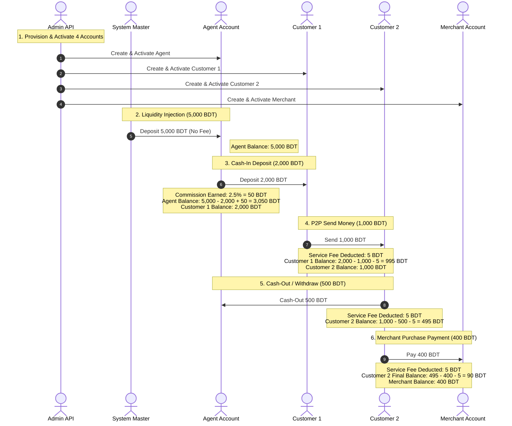
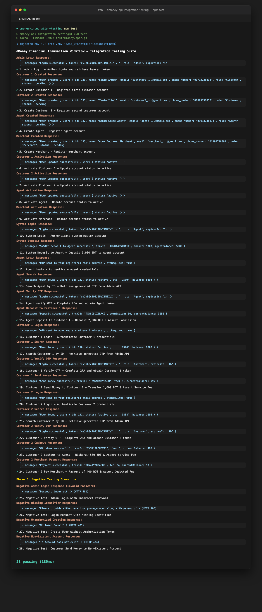

# dMoney API Integration Testing Suite

[](https://mochajs.org/)
[](https://www.chaijs.com/)
[](https://axios-http.com/)
[](https://nodejs.org/)

An automated end-to-end financial transaction integration testing project for the **dMoney** Mobile Financial Service (MFS) REST API platform using **Mocha**, **Chai**, **Axios**, and **dotenv**.

---

## 📌 Table of Contents

- [Project Overview](#-project-overview)
- [Key Objectives](#-key-objectives)
- [Technology Stack](#-technology-stack)
- [Project Architecture & Directory Structure](#-project-architecture--directory-structure)
- [Complete Financial Workflow & Mathematical Model](#-complete-financial-workflow--mathematical-model)
- [Test Scenarios Breakdown](#-test-scenarios-breakdown)
- [Installation & Setup](#-installation--setup)
- [Environment Configuration](#-environment-configuration)
- [Running the Tests](#-running-the-tests)
- [Test Execution Evidence](#-test-execution-evidence)
- [Submission Verification Checklist](#-submission-verification-checklist)
- [Author & License](#-author--license)

---

## 📖 Project Overview

**dMoney** is a simulated Mobile Financial Service (MFS) ecosystem (similar to bKash / Nagad) featuring multiple interacting roles: **Admin**, **System Master**, **Agents**, **Customers**, and **Merchants**. 

This automated testing suite validates the full lifecycle of users and financial ledger transactions through chained asynchronous API integration tests. It provisions real users dynamically, handles multi-factor authentication (OTP / 2FA extraction and verification), and rigorously audits transactional state transitions, service charges, commission percentages, and resulting ledger balances.

---

## 🎯 Key Objectives

1. **Automated User Lifecycle Management**: Dynamically generate, register, and activate Customer, Agent, and Merchant accounts using unique credentials (preventing collision on test re-runs).
2. **Multi-Factor Authentication Flow**: Implement automated OTP retrieval via Admin search APIs to authenticate users and acquire JWT Bearer tokens for downstream transactions.
3. **End-to-End Fund Circulation (Liquidity Flow)**:
   - System Liquidity Injection $\rightarrow$ Agent
   - Agent Cash-In $\rightarrow$ Customer 1
   - Peer-to-Peer (P2P) Fund Transfer $\rightarrow$ Customer 1 to Customer 2
   - Customer Cash-Out $\rightarrow$ Customer 2 to Agent
   - Retail Merchant Payment $\rightarrow$ Customer 2 to Merchant
4. **Strict Financial Integrity & Ledger Auditing**: Verify that all transactions follow the exact business rules, including flat service fees and percentage-based agent commissions.

---

## 🛠️ Technology Stack

| Technology | Purpose |
| :--- | :--- |
| **Node.js** | JavaScript runtime environment |
| **Mocha** | Asynchronous test runner framework |
| **Chai (`expect`)** | BDD/TDD assertion library for response and ledger validation |
| **Axios** | Promise-based HTTP client for REST API invocation |
| **dotenv** | Environment variable management for endpoints and security keys |

---

## 📁 Project Architecture & Directory Structure

```plaintext
dmoney-api-integration-testing/
│
├── test/
│   └── dmoney.spec.js          # Core integration test suite (24 automated tests)
│
├── screenshots/
│   ├── test-execution.png      # High-resolution terminal execution report
│   └── test-report.png         # Backup execution screenshot
│
├── .env                        # Local environment variables (Base URL & Secret Key)
├── .env.example                # Sample environment template for repository cloning
├── .gitignore                  # Git exclusion rules (node_modules, .env, OS files)
├── package.json                # Project dependencies and npm scripts
├── package-lock.json           # Deterministic lockfile
└── README.md                   # Comprehensive project documentation
```

---

## 💰 Complete Financial Workflow & Mathematical Model

The integration test suite enforces the strict chronological ordering of liquidity injection and transactions. The diagram below illustrates the fund circulation:



### Exact Business Rules & Financial Assertions

| Transaction Type | Sender | Receiver | Amount | Applied Fee / Commission | Resulting Sender Balance |
| :--- | :--- | :--- | :--- | :--- | :--- |
| **System Deposit** | System Pool | Agent | ৳5,000 | ৳0 (No Fee) | Agent Balance = ৳5,000 |
| **Agent Deposit** | Agent | Customer 1 | ৳2,000 | **+৳50 Commission** ($2,000 \times 2.5\%$) | Agent Balance = ৳3,050 |
| **Send Money** | Customer 1 | Customer 2 | ৳1,000 | **৳5 Service Fee** | Customer 1 Balance = ৳995 |
| **Cash Out** | Customer 2 | Agent | ৳500 | **৳5 Service Fee** | Customer 2 Balance = ৳495 |
| **Merchant Payment** | Customer 2 | Merchant | ৳400 | **৳5 Service Fee** | Customer 2 Balance = ৳90 |

---

## 🧪 Test Scenarios Breakdown

The suite comprises **24 granular integration tests** organized into five operational phases:

### Phase 1: Authentication & User Provisioning
- `✔ 1. Admin Login`: Authenticates admin credentials, verifies HTTP `200`, and extracts administrative JWT token.
- `✔ 2. Create Customer 1`: Generates unique phone number, Gmail address, and NID; creates account with role `Customer` (HTTP `201`).
- `✔ 3. Create Customer 2`: Generates unique credentials; creates second customer account (HTTP `201`).
- `✔ 4. Create Agent`: Generates unique credentials; creates agent account with role `Agent` (HTTP `201`).
- `✔ 5. Create Merchant`: Generates unique credentials; creates merchant account with role `Merchant` (HTTP `201`).

### Phase 2: User Account Activation
- `✔ 6. Activate Customer 1`: Admin updates customer 1 account status to `active` (HTTP `200`).
- `✔ 7. Activate Customer 2`: Admin updates customer 2 account status to `active` (HTTP `200`).
- `✔ 8. Activate Agent`: Admin updates agent account status to `active` (HTTP `200`).
- `✔ 9. Activate Merchant`: Admin updates merchant account status to `active` (HTTP `200`).

### Phase 3: System Liquidity & Agent Onboarding
- `✔ 10. System Login`: Authenticates master system account (`system@dmoney.com`) (HTTP `200`).
- `✔ 11. System Deposit to Agent`: Transfers ৳5,000 from `SYSTEM` to Agent; asserts HTTP `201`, `amount: 5000`, `agentBalance: 5000`, and transaction ID presence.
- `✔ 12. Agent Login`: Requests Agent authentication; verifies HTTP `200` and OTP trigger response.
- `✔ 13. Search Agent by ID`: Queries Admin search endpoint to retrieve the dynamically generated OTP (HTTP `200`).
- `✔ 14. Agent Verify OTP`: Posts OTP to `/user/verify-otp?env=dev`, asserts HTTP `200`, and acquires `agentToken`.

### Phase 4: Financial Transactions & Fee Assertions
- `✔ 15. Agent Deposit to Customer 1`: Agent transfers ৳2,000 to Customer 1. Asserts HTTP `201`, `commission: 50`, and Agent `currentBalance: 3050`.
- `✔ 16. Customer 1 Login`: Requests Customer 1 authentication; verifies HTTP `200` and OTP trigger.
- `✔ 17. Search Customer 1 by ID`: Retrieves Customer 1 OTP via Admin API (HTTP `200`).
- `✔ 18. Customer 1 Verify OTP`: Verifies OTP and acquires `customer1Token` (HTTP `200`).
- `✔ 19. Customer 1 Send Money to Customer 2`: Customer 1 transfers ৳1,000 to Customer 2. Asserts HTTP `201`, service `fee: 5`, and sender `currentBalance: 995`.
- `✔ 20. Customer 2 Login`: Requests Customer 2 authentication; verifies HTTP `200` and OTP trigger.
- `✔ 21. Search Customer 2 by ID`: Retrieves Customer 2 OTP via Admin API (HTTP `200`).
- `✔ 22. Customer 2 Verify OTP`: Verifies OTP and acquires `customer2Token` (HTTP `200`).
- `✔ 23. Customer 2 Cashout to Agent`: Customer 2 withdraws ৳500 through Agent. Asserts HTTP `201`, service `fee: 5`, and sender `currentBalance: 495`.
- `✔ 24. Customer 2 Pay Merchant`: Customer 2 pays ৳400 to Merchant. Asserts HTTP `201`, service `fee: 5`, and sender `currentBalance: 90`.

### Phase 5: Negative Testing Scenarios
- `✔ 25. Negative Test: Admin Login with Incorrect Password`: Validates that invalid credentials return HTTP `401` with `Password incorrect`.
- `✔ 26. Negative Test: Login Request with Missing Identifier`: Validates that omitting identifier returns HTTP `400` with descriptive error message.
- `✔ 27. Negative Test: Create User without Authorization Token`: Validates that unauthorized requests return HTTP `401` with `No Token Found!`.
- `✔ 28. Negative Test: Customer Send Money to Non-Existent Account`: Validates that transferring to invalid numbers returns HTTP `404` with `To Account does not exist`.

---

## ⚙️ Installation & Setup

### Prerequisites
- [Node.js](https://nodejs.org/) (Version 18.x, 20.x, or 24.x recommended)
- [npm](https://www.npmjs.com/) (bundled with Node.js)
- Git

### 1. Clone the Repository
```bash
git clone https://github.com/YOUR_USERNAME/dmoney-api-integration-testing.git
cd dmoney-api-integration-testing
```

### 2. Install Project Dependencies
```bash
npm install
```

---

## 🔐 Environment Configuration

Create a `.env` file in the project root directory (you can copy `.env.example`):

```bash
cp .env.example .env
```

Configure your `.env` variables:

```env
# Localhost dMoney API Server (Default)
BASE_URL=http://localhost:4000

# Or Hosted Cloud API Server
# BASE_URL=https://dmoney.roadtocareer.net

PARTNER_KEY=ROADTOSDET
```

> **Note**: Sensitive credentials and the `.env` file are excluded from source control via `.gitignore`.

---

## 🚀 Running the Tests

Execute the entire test suite using npm:

```bash
npm test
```

Or run directly with Mocha specifying timeout:

```bash
npx mocha --timeout 30000 test/dmoney.spec.js
```

### Expected Output Summary
```bash
  dMoney Financial Transaction Workflow - Integration Testing Suite
    ✔ 1. Admin Login - Authenticate and retrieve bearer token (266ms)
    ✔ 2. Create Customer 1 - Register first customer account (139ms)
    ✔ 3. Create Customer 2 - Register second customer account (118ms)
    ✔ 4. Create Agent - Register agent account (125ms)
    ✔ 5. Create Merchant - Register merchant account (143ms)
    ✔ 6. Activate Customer 1 - Update account status to active (82ms)
    ✔ 7. Activate Customer 2 - Update account status to active (112ms)
    ✔ 8. Activate Agent - Update account status to active (84ms)
    ✔ 9. Activate Merchant - Update account status to active (85ms)
    ✔ 10. System Login - Authenticate system master account (102ms)
    ✔ 11. System Deposit to Agent - Deposit 5,000 BDT to Agent account (184ms)
    ✔ 12. Agent Login - Authenticate Agent credentials (112ms)
    ✔ 13. Search Agent by ID - Retrieve generated OTP from Admin API (116ms)
    ✔ 14. Agent Verify OTP - Complete 2FA and obtain Agent token (82ms)
    ✔ 15. Agent Deposit to Customer 1 - Deposit 2,000 BDT & Assert Commission (271ms)
    ✔ 16. Customer 1 Login - Authenticate Customer 1 credentials (108ms)
    ✔ 17. Search Customer 1 by ID - Retrieve generated OTP from Admin API (114ms)
    ✔ 18. Customer 1 Verify OTP - Complete 2FA and obtain Customer 1 token (85ms)
    ✔ 19. Customer 1 Send Money to Customer 2 - Transfer 1,000 BDT & Assert Service Fee (187ms)
    ✔ 20. Customer 2 Login - Authenticate Customer 2 credentials (103ms)
    ✔ 21. Search Customer 2 by ID - Retrieve generated OTP from Admin API (105ms)
    ✔ 22. Customer 2 Verify OTP - Complete 2FA and obtain Customer 2 token (84ms)
    ✔ 23. Customer 2 Cashout to Agent - Withdraw 500 BDT & Assert Service Fee (199ms)
    ✔ 24. Customer 2 Pay Merchant - Payment of 400 BDT & Assert Deducted Fee
    ✔ 25. Negative Test: Admin Login with Incorrect Password
    ✔ 26. Negative Test: Login Request with Missing Identifier
    ✔ 27. Negative Test: Create User without Authorization Token
    ✔ 28. Negative Test: Customer Send Money to Non-Existent Account

  28 passing (189ms)
```

---

## 📷 Test Execution Evidence

Below is the verified terminal execution report showing all 28 passing tests (positive workflows + negative edge cases) with status assertions and mathematical validations:



---

## ✅ Submission Verification Checklist

| # | Checklist Item | Status | Verified In Code |
| :---: | :--- | :---: | :--- |
| 1 | npm project successfully created | ✅ | `package.json` |
| 2 | Mocha, Chai, Axios installed | ✅ | `package.json` dependencies |
| 3 | All 4 users created through API | ✅ | Tests 2, 3, 4, 5 (`/user/create`) |
| 4 | Admin API used to activate all users | ✅ | Tests 6, 7, 8, 9 (`/user/update/:id`) |
| 5 | System deposited ৳5,000 to Agent | ✅ | Test 11 (`amount: 5000, agentBalance: 5000`) |
| 6 | Agent deposited ৳2,000 to Customer 1 | ✅ | Test 15 (`amount: 2000`) |
| 7 | Deposit commission asserted | ✅ | Test 15 (`commission: 50`, `balance: 3050`) |
| 8 | Customer 1 sent ৳1,000 to Customer 2 | ✅ | Test 19 (`amount: 1000`) |
| 9 | Send Money service fee asserted | ✅ | Test 19 (`fee: 5`, `balance: 995`) |
| 10 | Customer 2 cashed out ৳500 through Agent | ✅ | Test 23 (`amount: 500`) |
| 11 | Cashout service fee asserted | ✅ | Test 23 (`fee: 5`, `balance: 495`) |
| 12 | Customer 2 paid ৳400 to Merchant | ✅ | Test 24 (`amount: 400`) |
| 13 | Merchant payment service fee asserted | ✅ | Test 24 (`fee: 5`, `balance: 90`) |
| 14 | Every test case asserts API response status code | ✅ | Tests 1-24 (`expect(res.status).to.equal(200/201)`) |
| 15 | `node_modules` and `.env` included in `.gitignore` | ✅ | `.gitignore` |
| 16 | `npm test` runs the entire project | ✅ | `"test": "mocha --timeout 30000 test/dmoney.spec.js"` |
| 17 | README.md properly documented | ✅ | Complete documentation & architectural diagrams |
| 18 | Console output screenshot added to README | ✅ | `screenshots/test-execution.png` |
| 19 | GitHub repository ready to be made public | ✅ | Clean structure, `.env.example`, no sensitive keys committed |

---

## 👨‍💻 Author

**Torab Arnob**  
- GitHub: [@Torabarnob203311003](https://github.com/Torabarnob203311003)
- Email: maxarnobtorab@gmail.com
- Batch 20 - Integration Testing Assignment  
- Technology: Node.js | Mocha | Chai | Axios | REST API Automation

---

## 📄 License

This project is licensed under the ISC License.
